# Stage 6 — Domain-Gap Analysis (zero-shot transfer to three other biomes)

> **Question.** The Stage 4 U-Net was trained only on one fire (Similipal, India, 2021).
> What happens when it is applied — unchanged, no fine-tuning — to a wetland fire (Pantanal),
> a Mediterranean forest fire (North Evia) and a boreal fire (Central Yakutia)?
> And can a cheap, label-free correction recover part of the loss?

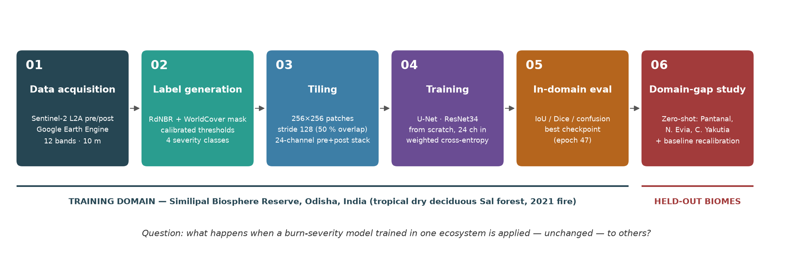

**Read this first (how much to trust the numbers).** This stage produces *measurements*
(agreement between model output and a lightweight reference labelling) and *hypotheses*
(why the agreement is low). The measurements are real; several of the explanations are
**consistent with the evidence but not isolated by an experiment**. Section 9 lists, claim by
claim, how strong the evidence is, and Section 10 lists the confounds. Two cheap follow-up
experiments that would separate the explanations are provided (Section 11).

---

## 1. TL;DR

| Region | Mean IoU | Mean Dice | Drop vs in-domain (0.6659) | Pixel acc. | Cohen κ |
|---|---|---|---|---|---|
| Similipal (in-domain, held-out patches) | **0.6659** | 0.7598 | — | 0.935 | 0.851 |
| N. Evia, Greece (2021) | 0.3124 | 0.4024 | −53.1 % | 0.714 | 0.322 |
| C. Yakutia, Russia (2021) | 0.2455 | 0.2906 | −63.1 % | 0.839 | 0.114 |
| Pantanal, Brazil (2020) | 0.1724 | 0.2621 | −74.1 % | 0.293 | 0.089 |
| Pantanal + baseline recalibration | 0.2203 | — | −66.9 % | — | — |

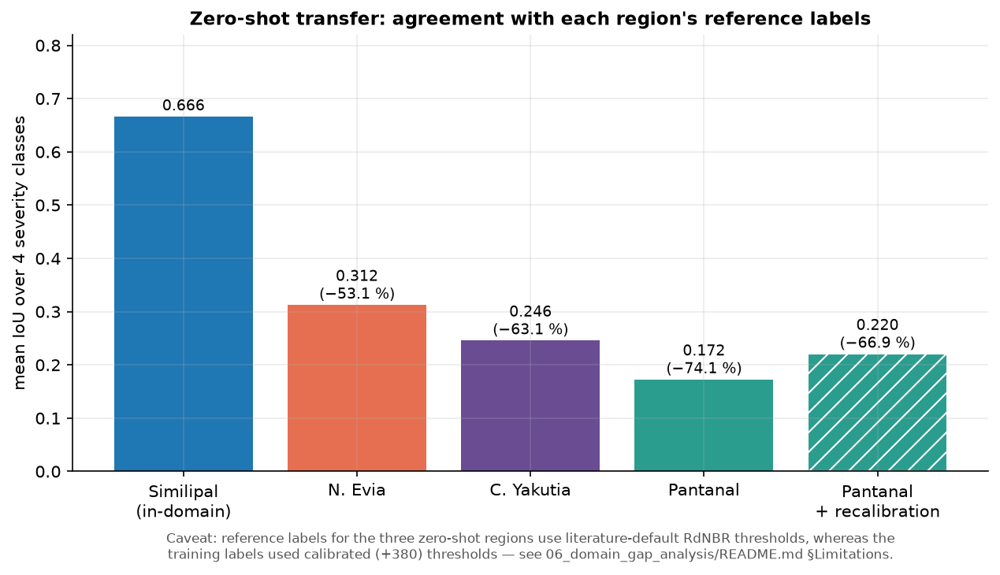

1. **Large cross-biome loss.** Every zero-shot region loses 53–74 % of in-domain mean IoU.
2. **The three regions fail in visibly different ways** (confusion matrices, Section 6) — but the
   *cause* of each pattern is a hypothesis (Section 9).
3. **Pre-fire baseline NBR shift does not rank the regions by performance drop** (n = 3, and the
   shift was computed over all pixels, including water — Section 5). It is *not* sufficient on its own.
4. **A one-parameter, label-free-in-form recalibration recovered +0.048 mean IoU in Pantanal**
   (+27.8 % relative, **9.7 % of the gap** to in-domain), and does nothing where the shift is ≈ 0. The
   strength was tuned against the same labels it is scored on, and the best value sits at the edge of
   the search grid (Section 8).

---

## 2. Study sites

Chosen to span fire regimes, fuels and climates, with a well-documented event each. All AOIs are small
(12–27 km) and sit inside **one** Sentinel-2 tile (see Section 3 for why).

| | Similipal (train) | Pantanal | North Evia | Central Yakutia |
|---|---|---|---|---|
| Biome | tropical dry deciduous (Sal) forest | seasonally flooded wetland / savanna / gallery forest | Mediterranean pine forest, maquis, olive agro-forestry | boreal taiga (deciduous larch) on permafrost |
| Event | Feb–Mar 2021 | Aug–Oct 2020 (peak late Aug–early Sep) | 3–≈10 Aug 2021 | record 2021 season (waves: late Jun–23 Jul, 24 Jul–17 Aug) |
| Typical fire | mostly surface fire under canopy | grass / peat / understory fire | fast, wind-driven crown fire in pine | crown / stand-replacing fire |
| AOI (lon/lat) | 86.05–86.75 E, 21.75–22.25 N | −56.90…−56.68, −17.40…−17.18 | 23.36–23.50 E, 38.82–38.92 N | 125.25–125.55 E, 61.68–61.92 N |
| Pre-fire window | 15 Jan–5 Feb 2021 | 1–20 Jul 2020 (scene 15 Jul) | 15 Jul–2 Aug 2021 | 1 May–20 Jun 2021 |
| Post-fire window | 20 Mar–10 Apr 2021 | 1 Dec 2020–15 Jan 2021 (scene 2 Dec) | 12 Aug–10 Sep 2021 | 15 Aug–20 Sep 2021 |
| Composite | median of ≈9 scenes | **single scene** (tile T21KWA) | **single scene**, tile pinned | **single scene**, tile pinned |

Event timelines come from: Mongabay-India and Down To Earth reporting plus FSI hotspot data (Similipal);
Libonati et al. 2020 *Nat. Ecol. Evol.* and Magalhães Neto et al. 2022 *Front. Environ. Sci.* (Pantanal);
the Copernicus EMS Evia imagery and an IAWF review of Greece's 2021 season (Evia); and
*Remote Sensing* 14(19):4980 and *Fire* 5(1):19 (Yakutia). Full references: `docs/GLOSSARY.md` §14.

> **Scene IDs.** The exact Sentinel-2 product IDs used for Evia and Yakutia are printed by
> `acquire_regions_v6.py` — paste them here for provenance:
> `Evia pre/post: <add from log>`, `Yakutia pre/post: <add from log>`.
> Pantanal: pre `S2B_MSIL2A_20200715T140059_N0214_R067_T21KWA_20200715T162437`,
> post `S2B_MSIL2A_20201202T140049_N0214_R067_T21KWA_20201202T162614`.

### Look at the data

| Pantanal | North Evia |
|---|---|
| 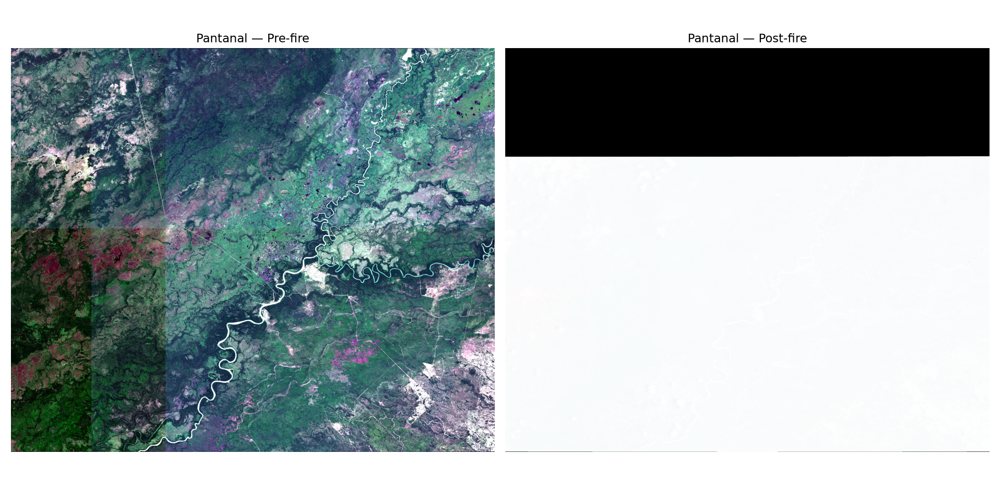 | 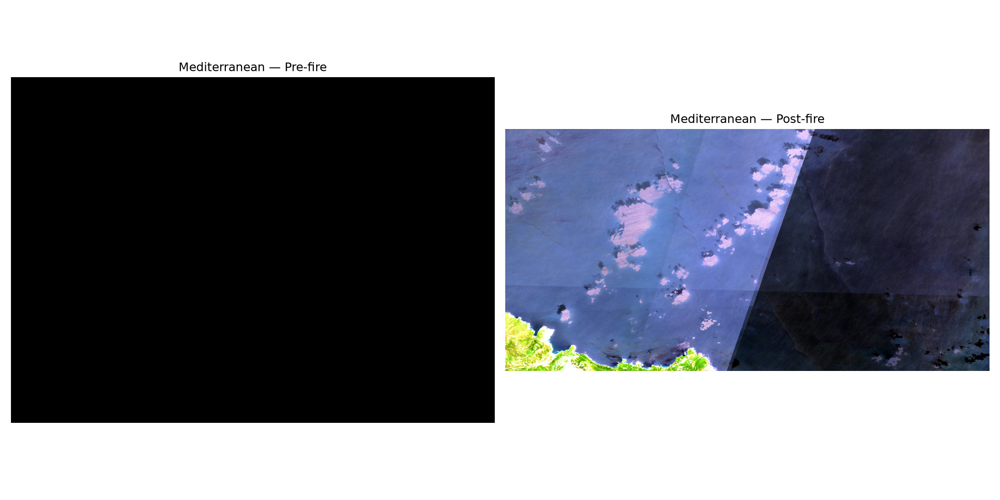 |

Yakutia (SWIR2/NIR/Red false colour — burn scars appear dark red/brown, healthy canopy green):

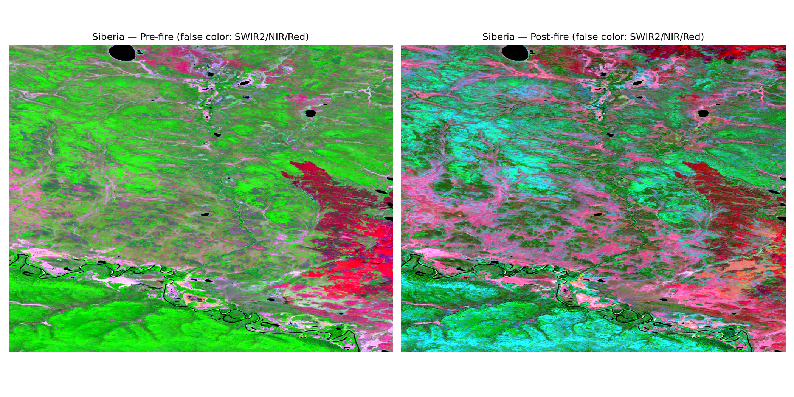

---

## 3. Acquisition: what went wrong (and the rules it produced)

Getting three clean image pairs took six iterations. The failures are the most reusable result of
this stage, so they are recorded here as rules.

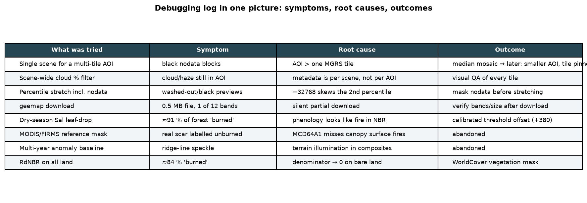

| Attempt | What happened | Root cause | Rule adopted |
|---|---|---|---|
| v1 median mosaic, big AOIs | Evia = open sea; Pantanal post-fire showed smoke; Yakutia seam | wrong coordinates (I mis-placed Evia twice), mosaicking across tiles/dates blends contamination | verify AOI on a map; **fix coordinates from named places** (Limni, Agia Anna, Mantoudi) |
| Pantanal post-fire = thermal spikes | B11/B12 maxima > 12 000 (valid ≲ 8 000) | active fire/smoke leaking into SWIR | push window after the fire; inspect **per-band max** |
| v4/v5 single scene | Evia pre-fire tile ≠ post-fire tile (41.7 % vs 100 % coverage) | "least cloudy" chosen independently per date | **pin both dates to one MGRS tile** (v6 `determine_best_tile`) |
| v5 downloads | `pantanal_pre_fire.tif` = 0.5 MB, only band 1 non-zero | silent partial download | **verify band count / non-zero % / file size after every download** |
| Preview of that file | all-black / all-white | percentile stretch included nodata (−32768) | **mask nodata before computing percentiles** |
| Yakutia post-fire magenta | band stats were normal | narrow blue range ⇒ per-band stretch distortion | inspect in **false colour**; do not trust a stretched true-colour preview |

Final rules: small AOI inside one tile → one scene per date from the *same* tile → coverage ≥ 95 % →
verify bands after download → QA in more than one band combination.

**Scripts (final):** `acquire_regions_v6.py` (all regions; Pantanal was acquired with v5 and its pre-fire
file re-downloaded with `redownload_pantanal_pre.py`), `verify_rgb_preview.py` (nodata-safe),
`verify_false_color.py` (Yakutia).

---

## 4. Vegetation masks (ESA WorldCover v200, per-region classes)

The model was trained only on pixels inside the Stage 2 vegetation mask. The same restriction is applied
here, but **the class list is chosen per biome** because the Similipal choice (tree cover + shrubland) would
discard most of a wetland:

| Region | WorldCover classes kept | Why |
|---|---|---|
| Pantanal | 10 tree, 20 shrub, 30 grass, **90 herbaceous wetland** | first run with 10+20 only masked out 53.9 % of the scene — most of it burned wetland |
| N. Evia | 10, 20, 30 | pine forest + maquis + grassland/olive mosaic |
| C. Yakutia | 10, 20 | taiga + shrub (unchanged → results were bit-identical before/after the Pantanal fix, confirming the mask was not the cause of Yakutia's behaviour) |

Caveat: WorldCover v200 is a **2021** map applied to a 2020 fire (Pantanal), and a freshly burned area may be
re-labelled bare/grass. The classes (30, 90) are also land covers the network **never saw in training**.

---

## 5. Baseline NBR shift (the hypothesised "ecological explanation")

Pre-fire NBR distributions (all valid pixels; `compute_baseline_shift.py`):

| Region | mean | median | SD | shift vs Similipal |
|---|---|---|---|---|
| Similipal | 0.270 | 0.256 | 0.241 | — |
| Pantanal | 0.449 | 0.481 | 0.172 | **+0.179** |
| N. Evia | 0.266 | 0.236 | 0.217 | −0.005 |
| C. Yakutia | 0.284 | 0.295 | 0.204 | +0.014 |

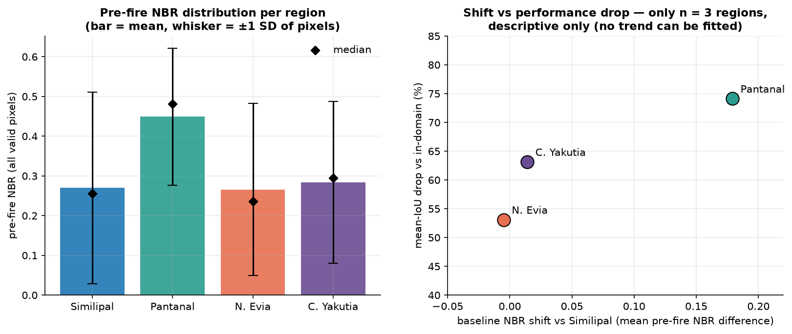

Two honest caveats:
* **Computed over all pixels**, not only vegetated ones. The Evia scene is roughly a third open sea, and
  water/bare land have unstable NBR, so the "≈ 0" for Evia is not a clean vegetation statement.
  `compute_baseline_shift_vegetated.py` (new, **not yet run**) restricts the statistic to the vegetation mask.
* **n = 3.** No trend can be fitted; the right panel is descriptive only. What it does show: Evia and Yakutia
  lose 53–63 % of IoU with a shift near zero, so whatever hurts them is not captured by this single number.

---

## 6. Zero-shot inference and results

**Procedure** (`zero_shot_inference.py`, `save_prediction_probabilities.py`): the Stage 4 checkpoint
(`best_model.pt`, epoch 47) is run on 256×256 windows with stride 128; overlapping outputs are averaged
(logits in the first script, softmax probabilities in the second — the argmax maps differ negligibly:
Pantanal mean IoU 0.17238 vs 0.17244); predictions outside the vegetation mask are set to *ignore*.
Edge strips narrower than one stride are not covered and are also ignored.

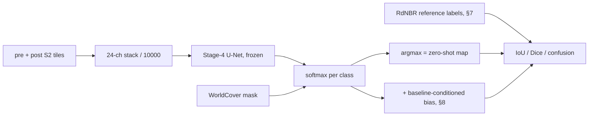

**Reference labels** (`generate_reference_labels.py`): plain RdNBR with the literature-default
Miller & Thode thresholds (69 / 315 / 640), vegetation-masked, **no calibration search**. Reference class
shares (% of total array; remainder = non-vegetated): Pantanal 18.0 / 21.8 / 26.0 / 30.3 ·
Evia 3.3 / 3.3 / 4.9 / 44.6 · Yakutia 62.2 / 6.7 / 1.0 / 0.8.

### 6.1 Per-class metrics

| Region | class | reference prevalence | precision | recall | Dice | IoU |
|---|---|---|---|---|---|---|
| **Pantanal** | unburned | 18.8 % | 0.367 | 0.979 | 0.533 | 0.364 |
| | low | 22.6 % | 0.021 | 0.019 | 0.020 | 0.010 |
| | moderate | 27.0 % | 0.047 | 0.032 | 0.038 | 0.019 |
| | high | 31.6 % | **0.922** | **0.304** | 0.457 | 0.296 |
| **N. Evia** | unburned | 3.1 % | 0.361 | 0.995 | 0.529 | 0.360 |
| | low | 4.4 % | 0.049 | 0.065 | 0.056 | 0.029 |
| | moderate | 8.2 % | 0.104 | 0.248 | 0.147 | 0.079 |
| | high | 84.2 % | 0.999 | 0.782 | 0.878 | 0.782 |
| **C. Yakutia** | unburned | 87.6 % | 0.892 | 0.951 | 0.921 | 0.853 |
| | low | 9.9 % | 0.071 | 0.005 | 0.010 | 0.005 |
| | moderate | 1.4 % | 0.116 | 0.052 | 0.072 | 0.037 |
| | high | 1.1 % | 0.097 | 0.466 | 0.160 | 0.087 |
| *Similipal (in-domain)* | high | 0.2 % | *0.213* | *0.923* | *0.346* | *0.209* |

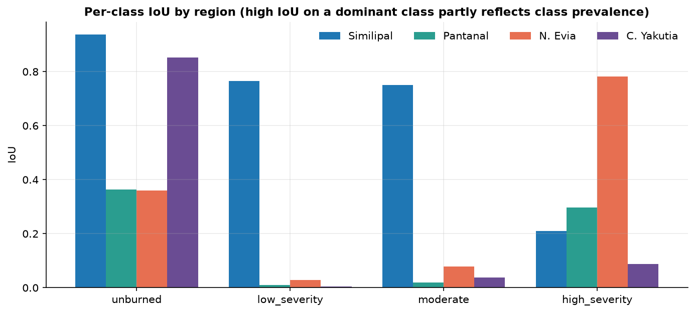

### 6.2 Confusion matrices (row-normalised; counts in brackets)

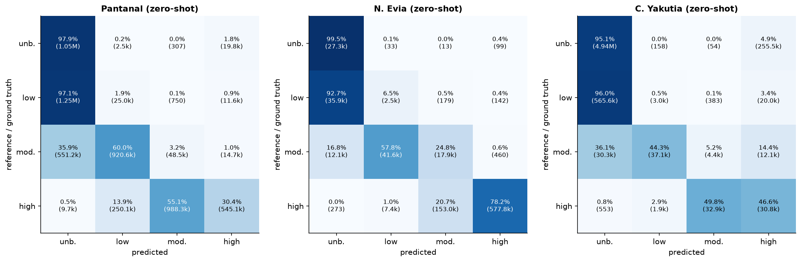

### 6.3 Reading the numbers correctly

* **IoU of a dominant class is easy.** Evia's `high` IoU of 0.78 and Yakutia's `unburned` IoU of 0.85 are
  largely *prevalence effects* (84 % and 88 % of the reference pixels). Compare κ instead: Evia 0.32,
  Yakutia 0.11, Pantanal 0.09 — all far below in-domain 0.85.
* **Mean IoU weights four very unequal classes equally**, so a region with one near-empty class is
  penalised heavily.
* These are agreements with a *reference labelling*, not with field truth (Section 10).

### 6.4 What the matrices show (observations, not causes)

* **Pantanal — severity is under-called.** 97 % of reference-`low` pixels are predicted `unburned`; 60 % of
  reference-`moderate` are predicted `low`; reference-`high` is split across `moderate` (62 %) / `high` (34 %)
  / `low` (16 %). The `high` class has **precision 0.92 but recall 0.30 — the reverse of in-domain** (recall
  0.92, precision 0.21). The model that over-calls `high_severity` at home is conservative in Pantanal.
* **N. Evia — the scene is mostly `high` in the reference** and the model predicts `high` for most of it
  (recall 0.78, precision 0.999); the mid classes are poorly separated (reference-`moderate` is mostly called
  `low`/`high`).
* **C. Yakutia — fire is largely missed**: reference-`low` recall 0.5 %; reference-`high` recall 47 % but
  precision 9.7 %. 4.9 % of reference-`unburned` pixels (255 541 px) are called `high`.

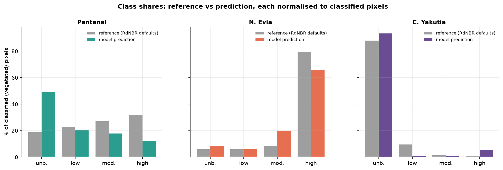

### 6.5 Where are Yakutia's false positives?

`check_siberia_false_positive.py` overlays them (bright cyan) on the false-colour scene. They are a
**diffuse speckle spread over green forest, not one localised patch** — so the earlier idea that a single
anomalous cyan area caused them was wrong.

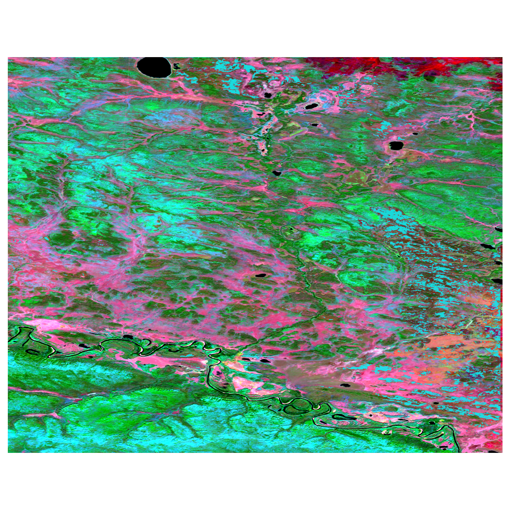

Reading: out-of-domain the network emits scattered low-confidence `high` calls rather than making one
identifiable mistake. *Why* is untested (candidate causes in §9).

---

## 7. Failure taxonomy (working hypotheses)

| | Pantanal | N. Evia | C. Yakutia |
|---|---|---|---|
| Signature | under-calls severity; mid-classes ≈ 0 IoU | `high` dominates; mid-classes poor | misses real fire; diffuse false `high` |
| Hypothesis | elevated pre-fire NBR (+0.18) and different cover (wetland/grass) shift the signal the network learned on forest | the model's `high` bias coincides with a scene that is mostly `high` under the reference rule | very different canopy/phenology (deciduous larch, permafrost, low sun) ⇒ inputs far from training distribution |
| Also plausible | reference-rule vs training-rule threshold mismatch; Jul→Dec seasonal change | same mismatch; sea pixels in baseline statistic | May→Aug leaf-on change; older burn scar visible in the pre-fire image |

---

## 8. Recalibration: baseline-conditioned logit bias

**Idea.** If a region's pre-fire NBR sits above Similipal's, a given severity produces a smaller NBR
*drop* relative to the learned thresholds, so the network under-calls severity. Nudge the class logits upward
in proportion to the shift.

For softmax probabilities *p<sub>c</sub>*, class index *c* ∈ {0,1,2,3} (ordered unburned → high), baseline shift *s*
and strength *α*:

```
ŷ = argmax_c [ log p_c + α · c · s ]
```

* *s* comes **only from pre-fire imagery** (no labels): Pantanal +0.179, Evia −0.005, Yakutia +0.014.
* *α* was chosen by sweeping {0, 1, 2, 3, 5, 7, 10, 15, 20} and keeping the best mean IoU **on the reference
  labels** — i.e. a one-parameter, in-sample calibration (same category of compromise as the Stage 2 threshold
  offset, and disclosed as such).

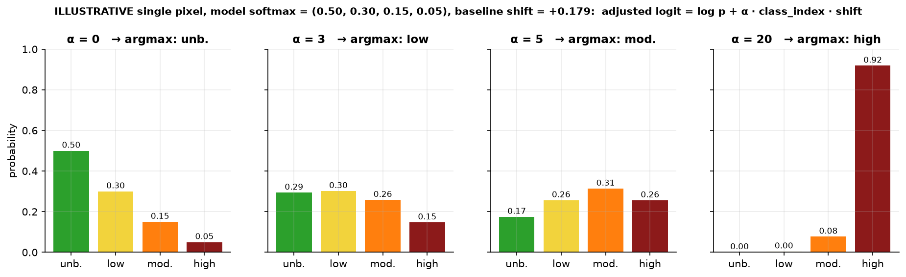

| Region | s | best α | mean IoU α = 0 → best | Δ |
|---|---|---|---|---|
| Pantanal | +0.179 | **20** | 0.1724 → **0.2203** | **+0.0479** (+27.8 %; recovers 9.7 % of the gap) |
| N. Evia | −0.005 | 0 | 0.3124 → 0.3124 | 0 |
| C. Yakutia | +0.014 | 0 | 0.2455 → 0.2455 | 0 |

Pantanal per-class IoU after correction: 0.451 / 0.033 / 0.090 / 0.308 (before 0.364 / 0.010 / 0.019 / 0.296).

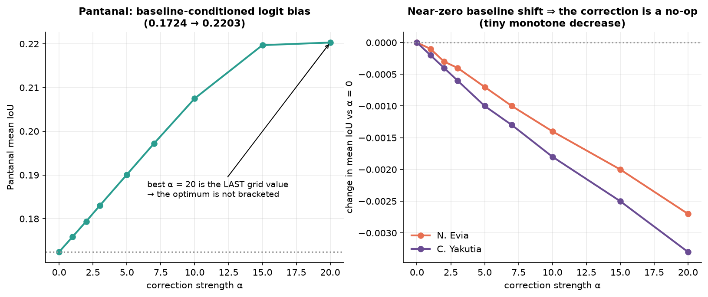

**How to read it**

* The two near-zero-shift regions are unchanged *by construction* (the bias term vanishes); that is a
  sanity check on the method, not independent evidence that it "diagnoses" anything.
* **α = 20 is the last value tried**, so the optimum is not bracketed. It is also a *large* correction:
  α·s = 3.6 nats per class step, enough to flip a pixel with p = (0.50, 0.30, 0.15, 0.05) to `high`
  (illustration above). It behaves less like a subtle calibration and more like a **label-prior shift** —
  which is exactly what you would also expect if the reference simply contains more severe pixels than the
  training rule would produce (Section 10, item 3).
* Gains are in `unburned`, `moderate` and `low` IoU; `high` barely moves.

---

## 9. Evidence strength, claim by claim

| # | Claim | Evidence | Status |
|---|---|---|---|
| 1 | Zero-shot agreement is far below in-domain | direct measurement (Section 6) | **observed**; magnitude uncertain (label-protocol mismatch, in-domain leakage — Section 10) |
| 2 | Baseline NBR shift alone does not explain the gap | 2 of 3 regions lose 53–63 % at ≈ 0 shift | **suggestive only** (n = 3; all-pixel statistic) |
| 3 | Pantanal under-calls severity; in-domain over-calls `high` | confusion matrices | **observed**; cause untested |
| 4 | Yakutia false positives are diffuse, not localised | overlay | **observed**; cause untested |
| 5 | Evia's high `high` IoU reflects scene composition | prevalence 84 % | **arithmetical** |
| 6 | Baseline-conditioned bias helps where shift is large | +0.048 in Pantanal | **observed, in-sample, edge-of-grid**; mechanism (reflectance baseline vs label prior) **not isolated** |
| 7 | Three distinct failure mechanisms | taxonomy §7 | **hypothesis** |

---

## 10. Limitations and confounds (please read)

1. **Spatial leakage in the in-domain number.** Stage 3 cuts 256-px patches with 50 % overlap and splits them
   *randomly*; validation patches share pixels with training patches. In-domain IoU (0.6659) is therefore
   optimistic, and the "drop" is overstated. A block/tile-wise split is needed.
2. **No independent test set.** The checkpoint was chosen on the same validation set whose score is reported.
3. **Label-protocol mismatch.** Training labels used a *calibrated* RdNBR rule (+380 offset; ≈ 29 % of
   vegetated Similipal burned). Reference labels here use *literature-default* thresholds. Even a network that
   reproduced its training rule perfectly would disagree with these references — and in the direction seen in
   Pantanal (reference has more severe pixels). **Part or all of the "gap" may be protocol, not ecology.**
4. **Label–input circularity.** Labels are a deterministic function of B8/B12 pre/post plus a mask — the
   network's inputs. In-domain IoU measures how well the network re-learned the labelling rule, not an
   independent fire detection.
5. **Reference labels are proxies, not ground truth** — no field data, no agency perimeters, no independent
   burned-area product.
6. **Temporal/phenological confounds.** Pantanal pre = July, post = December (dry → wet-season onset). Yakutia
   pre = May–June (larch leaf-out), post = Aug–Sep. Pre/post differences include non-fire change, the same
   problem that dominated Stage 2.
7. **Baseline statistic includes non-vegetated pixels** (water in Evia).
8. **Contamination is not masked per pixel** — only scene-level cloud % ≤ 20 %; thin cirrus/smoke can remain
   (Yakutia 2021 had extreme smoke). The Yakutia pre-fire scene also contains what looks like an older burn
   scar.
9. **n = 1 event per biome, one small AOI each, one date pair, one training run** — no seeds, no confidence
   intervals. Epoch-to-epoch validation noise in Stage 4 was ±0.1 mean IoU, comparable to some effects here.
10. **Recalibration is tuned in-sample** and at the grid edge (Section 8).
11. **Class prevalence differs wildly between scenes**, so mean IoU is not comparable across regions in a
    strict sense; κ and per-class precision/recall are provided for that reason.
12. **WorldCover 2021 as a mask for all years**, and region-specific class lists are a judgement call.

---

## 11. Recommended next experiments (cheap, would turn hypotheses into findings)

1. **Separate "protocol gap" from "ML generalisation gap"** — `decompose_gap_by_label_rule.py` (new, not yet run)
   scores the unchanged predictions against two references: the default rule (+0) and the *Similipal rule*
   (+380). If agreement with the Similipal-rule reference is much higher, most of the measured gap is label
   protocol; the remainder is genuine generalisation loss.
2. **Vegetation-only baseline shift** — `compute_baseline_shift_vegetated.py` (new, not yet run).
3. **Independent references:** Copernicus EMS delineation for Evia, a national/regional burned-area product
   for Pantanal (e.g. MapBiomas Fogo), GWIS/GlobFire perimeters for Yakutia (check availability/licences).
4. **Spatially blocked train/val/test split** and repeat training with several seeds.
5. **Feature-space domain gap:** PCA/t-SNE or CKA on encoder activations per region.
6. **Cheap adaptation baselines:** AdaBN / test-time BatchNorm statistics, few-shot fine-tuning, per-band
   normalisation by scene statistics, ordinal-aware losses.
7. **Seasonal-matched pre-fire imagery** (same phenological stage as post-fire) for Pantanal and Yakutia.

---

## 12. Files

| Path | Purpose |
|---|---|
| `acquire_regions_v6.py` | single-scene, tile-pinned acquisition (Evia, Yakutia) |
| `redownload_pantanal_pre.py` | re-fetch + verify the corrupted Pantanal pre-fire file |
| `verify_rgb_preview.py`, `verify_false_color.py` | nodata-safe QA previews |
| `diagnose_pantanal_post.py`, `inspect_pantanal_files.py`, `diagnose_siberia_post.py` | per-band diagnostics |
| `fetch_vegetation_masks.py` | per-region WorldCover masks |
| `zero_shot_inference.py` | zero-shot class maps |
| `save_prediction_probabilities.py` | 4-band softmax rasters (large — git-ignored) |
| `compute_baseline_shift.py` | all-pixel baseline NBR statistics |
| `generate_reference_labels.py` | RdNBR (default thresholds) reference labels |
| `evaluate_domain_gap.py` → `results/domain_gap_results.json` | per-region IoU/Dice/confusion |
| `recalibrate_and_evaluate.py` → `results/recalibration_results.json` | α sweep |
| `check_siberia_false_positive.py` | Yakutia false-positive overlay |
| **new, untested:** `compute_baseline_shift_vegetated.py`, `decompose_gap_by_label_rule.py` | Section 11 experiments |

Superseded acquisition versions (`acquire_regions.py`, `_v4`, `_v5`) can be moved to an `archive/` folder.

**Run order:** `acquire_regions_v6.py` → `verify_*` → `fetch_vegetation_masks.py` →
`compute_baseline_shift.py` → `generate_reference_labels.py` → `save_prediction_probabilities.py` →
`evaluate_domain_gap.py` → `recalibrate_and_evaluate.py` (+ the two new experiments).
Figures: `python docs/make_figures.py`.

Terminology (RdNBR, IoU, κ, logit adjustment, domain shift, leakage …): see [`docs/GLOSSARY.md`](../docs/GLOSSARY.md).
