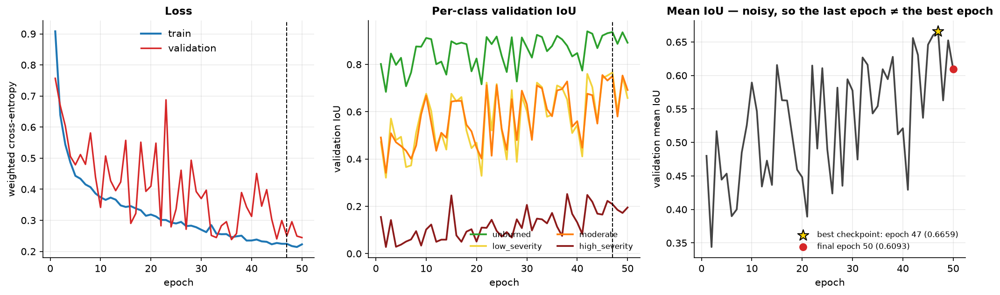
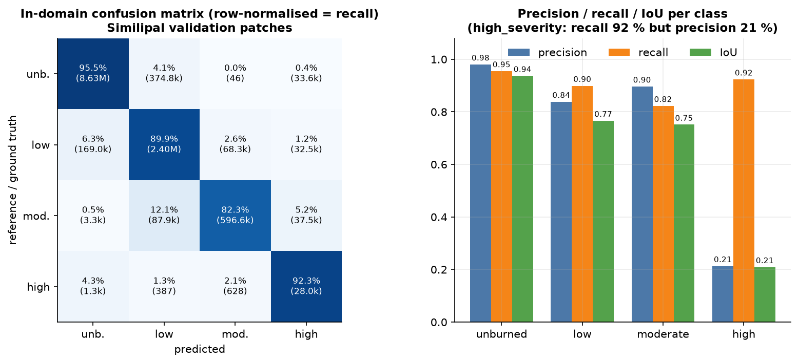
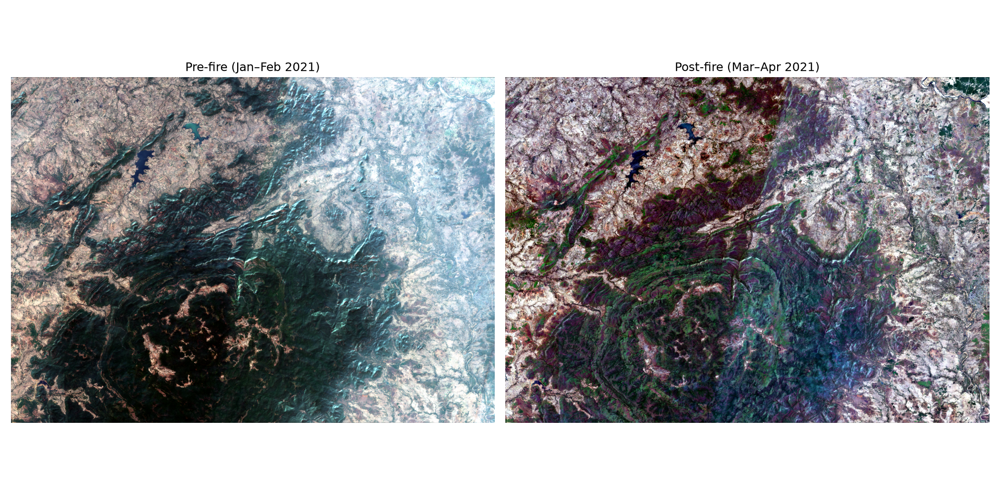
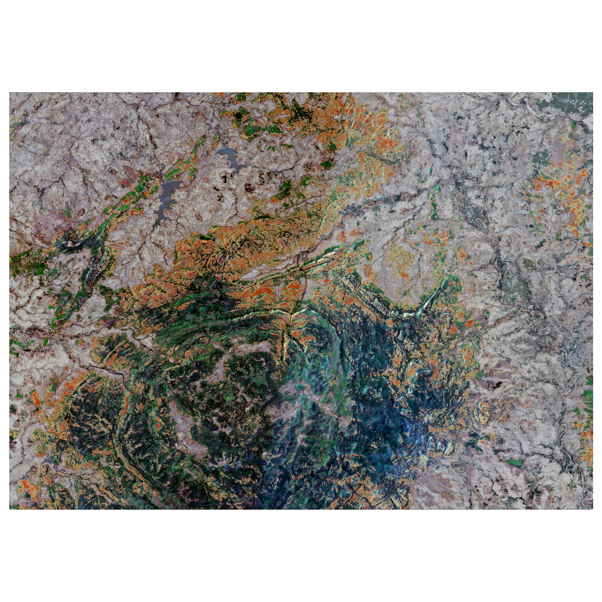
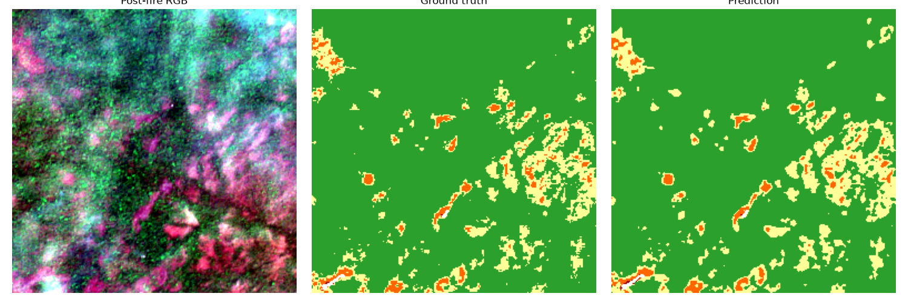
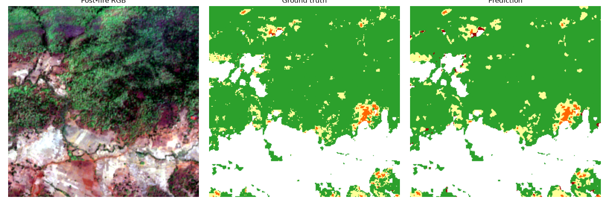

# Wildfire Burn Scar Segmentation

**Train a burn-severity model on one fire, then test it — unchanged — on three different ecosystems, and find out what breaks.**
Sentinel-2 · Google Earth Engine · U-Net/ResNet34 (PyTorch) · zero-shot domain-gap analysis


---

## 1. What this project asks

Burn-severity maps are normally produced with one index (dNBR/RdNBR) and thresholds tuned for the ecosystem they
were developed in. A neural network can learn those maps from raw bands — but **does it keep working when the
ecosystem changes?** I trained on the 2021 Similipal Biosphere Reserve fire (Odisha, India; tropical dry deciduous
Sal forest) and applied the model with no fine-tuning to:

| Region | Biome | Fire |
|---|---|---|
| **Pantanal** (Encontro das Águas), Brazil | seasonally flooded wetland / savanna | 2020 drought fires |
| **North Evia**, Greece | Mediterranean pine forest & maquis | Aug 2021 wind-driven fire |
| **Central Yakutia**, Russia | boreal larch taiga on permafrost | record 2021 season |

## 2. Headline results

| | Mean IoU | Mean Dice | Drop |
|---|---|---|---|
| Similipal — in-domain (held-out patches) | **0.666** | 0.760 | — |
| N. Evia (zero-shot) | 0.312 | 0.402 | −53 % |
| C. Yakutia (zero-shot) | 0.246 | 0.291 | −63 % |
| Pantanal (zero-shot) | 0.172 | 0.262 | −74 % |
| Pantanal + baseline-conditioned recalibration | 0.220 | — | −67 % |


**What I can say with reasonable confidence**

* Agreement with the zero-shot reference labels is far below the in-domain score in all three regions.
* The regions fail differently. In Pantanal the model **under-calls severity** (`high_severity`: precision 0.92, recall 0.30 —
  the reverse of in-domain, 0.21 / 0.92). In Yakutia it **misses most real fire** and scatters false `high` calls over unburned
  forest. In Evia, whose scene is 84 % `high` under the reference rule, `high` is recovered well (IoU 0.78) — largely a
  class-prevalence effect.
* Pre-fire NBR baseline shift does not rank the regions by performance drop (two of three lose 53–63 % at ≈ 0 shift).
* A one-parameter logit bias scaled by that shift recovers **+0.048 mean IoU in Pantanal (≈ 9.7 % of the gap)** and is a no-op
  where the shift is ≈ 0.

**What I cannot yet claim** — and why (details in §7 and `06_domain_gap_analysis/README.md` §9–10): the in-domain score is
optimistic (overlapping patches split randomly, no independent test set); the zero-shot reference labels use a different
threshold rule from the training labels, so part of the "gap" may be label protocol rather than ecology; and explanations for each
failure are hypotheses, not isolated causes. Two cheap scripts to test this are included and **not yet run**.


---

## 3. The pipeline

| Stage | What happens | Key decisions | Docs |
|---|---|---|---|
| **01 Data acquisition** | Pre/post Sentinel-2 L2A (12 bands, 10 m) for Similipal via Earth Engine; median mosaic of ≈ 9 scenes per window | windows 15 Jan–5 Feb and 20 Mar–10 Apr 2021; B12 resampled 20→10 m | [01](01_data_acquisition/README.md) |
| **02 Label generation** | RdNBR inside an ESA WorldCover vegetation mask → 4 severity classes + `not_applicable` | thresholds shifted **+380** to counter dry-season leaf-drop (≈ 28.7 % burned); four alternatives rejected | [02](02_label_generation/README.md) |
| **03 Tiling** | 256 × 256 patches, stride 128, 24-channel pre+post stack; 1 485 patches, 85/15 split | pixel mix 59.6 / 20.3 / 6.0 / **0.24** % (+ 13.9 % n/a) | [03](03_tiling/README.md) |
| **04 Training** | U-Net/ResNet34 from scratch, weighted cross-entropy (weights 0.36 / 1.06 / 3.60 / **91.2**), `ignore_index` for n/a, Adam 1e-4, batch 8, 50 epochs | best checkpoint = epoch 47 | [04](04_training/README.md) |
| **05 Evaluation** | IoU/Dice/confusion on held-out patches | `high_severity` recall 0.92, precision 0.21 — documented, not retrained | [05](05_evaluation/README.md) |
| **06 Domain gap** | zero-shot inference on three biomes, baseline-shift analysis, reference labels, recalibration | single-scene tile-pinned acquisition after six failed attempts | [06](06_domain_gap_analysis/README.md) |




### Evidence from the pipeline (generated by the scripts)

| Stage 1 — pre/post RGB | Stage 2 — severity overlay |
|---|---|
|  |  |

| Stage 5 — RGB / reference / prediction | Stage 5 — another patch |
|---|---|
|  |  |

| Pantanal | North Evia | Yakutia false-positive overlay (cyan) |
|---|---|---|
|  |  |  |

---

## 4. Ideas you may want to reuse

* **Debugging log as a deliverable.** The failures taught more than the model: see the table below and
  `06_domain_gap_analysis/README.md` §3.


* **Per-class metrics + prevalence + κ**, not just accuracy or mean IoU.
* **Assert on every download** (bands, % non-zero, file size, tile coverage).
* **Label the compromises.** The +380 offset, the in-sample α and the proxy labels are stated, not hidden.

## 5. Repository layout

```
.
├── README.md                     ← you are here
├── docs/
│   ├── GLOSSARY.md               concepts, why-we-used-it, references (figures included)
│   ├── make_figures.py           regenerates every figure from logged numbers
│   └── images/                   fig01 … fig17
├── 01_data_acquisition/          acquire_similipal.py, verify_rgb_preview.py
├── 02_label_generation/          fetch_landcover_mask.py, compute_dnbr.py (RdNBR + offset),
│                                 calibrate_threshold.py, overlay_severity_check.py
├── 03_tiling/                    tile_dataset.py  → patches/ (git-ignored) + manifests
├── 04_training/                  dataset.py, train.py → checkpoints/ (git-ignored)
├── 05_evaluation/                evaluate.py → results/
└── 06_domain_gap_analysis/       acquire_regions_v6.py, zero_shot_inference.py, …
                                  evaluate_domain_gap.py, recalibrate_and_evaluate.py
```

## 6. Reproduce

```bash
python -m venv .venv && source .venv/bin/activate
pip install earthengine-api geemap geedim rasterio numpy scipy scikit-learn matplotlib \
            torch segmentation-models-pytorch
earthengine authenticate        # then set YOUR Earth Engine Cloud project id inside the scripts
```

1. `01_data_acquisition/acquire_similipal.py` → `verify_rgb_preview.py` (≈ 10–25 min of downloads)
2. `02_label_generation/fetch_landcover_mask.py` → `compute_dnbr.py` → `overlay_severity_check.py`
3. `03_tiling/tile_dataset.py` → 4. `04_training/train.py` (≈ 1–2 h on Apple M-series MPS) → 5. `05_evaluation/evaluate.py`
6. Stage 6 run order is listed in `06_domain_gap_analysis/README.md` §12. Large rasters, patches and checkpoints are git-ignored;
   re-create them with the scripts (or attach the checkpoint to a GitHub Release).
7. `python docs/make_figures.py` rebuilds the figures.

## 7. Limitations (read before citing any number)

1. **Spatial leakage:** 50 %-overlapping patches were split randomly, so validation patches share pixels with training patches;
   the in-domain score is optimistic. **No independent test set**; the checkpoint was selected on the validation set it is reported on.
2. **Proxy labels:** labels are an RdNBR rule (with a hand-calibrated +380 offset) applied to the same bands the network sees —
   in-domain IoU measures how well the rule was re-learned, not independent fire detection.
3. **Label-protocol mismatch:** zero-shot references use literature-default thresholds; the training rule differed. Some of the
   measured "gap" may be this, not ecology.
4. **Phenology/temporal confounds** (Pantanal Jul→Dec, Yakutia May→Aug, Similipal dry-season leaf-drop).
5. **n = 1 event per biome, one small AOI and one date pair each, one training run, no seeds or confidence intervals.**
6. **Baseline shift computed over all pixels** (including water); n = 3 — descriptive only.
7. **Recalibration tuned in-sample**, best α at the edge of the search grid.
8. Scene-level cloud filtering only; smoke/cirrus not masked per pixel. WorldCover 2021 used as mask for all years.

## 8. Next steps

Run `decompose_gap_by_label_rule.py` and `compute_baseline_shift_vegetated.py`; block-wise spatial split with several seeds;
independent burned-area references (Copernicus EMS for Evia, MapBiomas Fogo for Pantanal, GWIS for Yakutia); seasonal-matched
pre-fire imagery; augmentation; cheap domain adaptation (AdaBN/Tent, few-shot fine-tuning); feature-space analysis of the
encoder; RBR instead of RdNBR.

## 9. Data, credits, licence

Contains modified Copernicus Sentinel data (2020–2021). ESA WorldCover © ESA, CC BY 4.0. MODIS/FIRMS data courtesy of NASA.
Event information from Mongabay-India, Down To Earth, Copernicus EMS and the papers listed in `docs/GLOSSARY.md` §15.
**Licence:** MIT. 2026 @ Tamojeet.

New to remote sensing or segmentation? Start with [`docs/GLOSSARY.md`](docs/GLOSSARY.md).