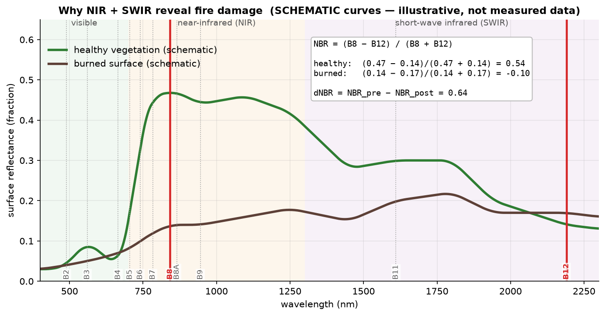
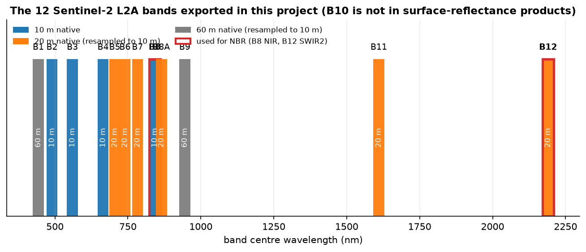
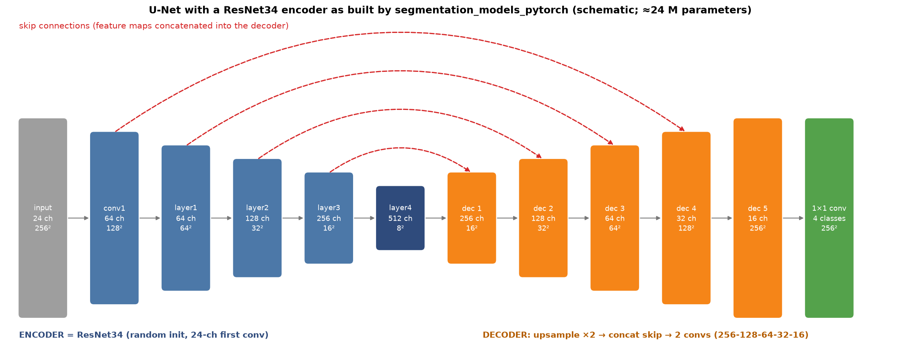
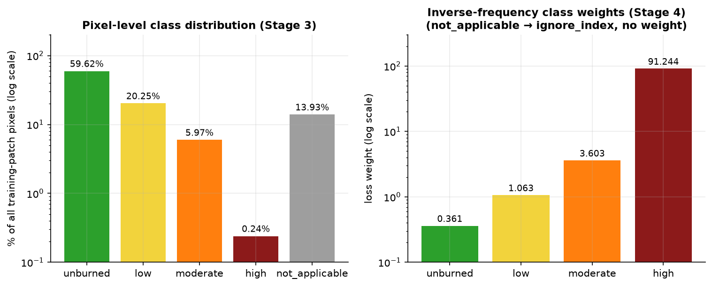
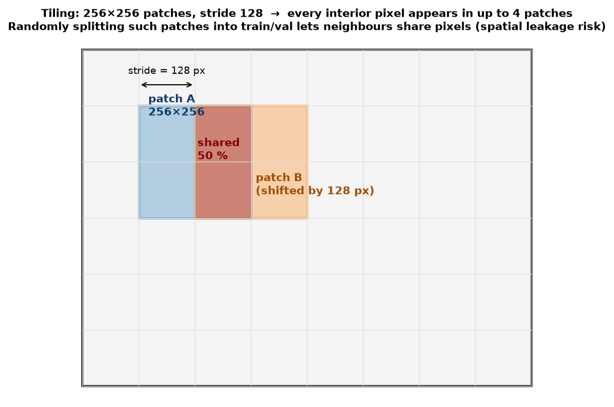
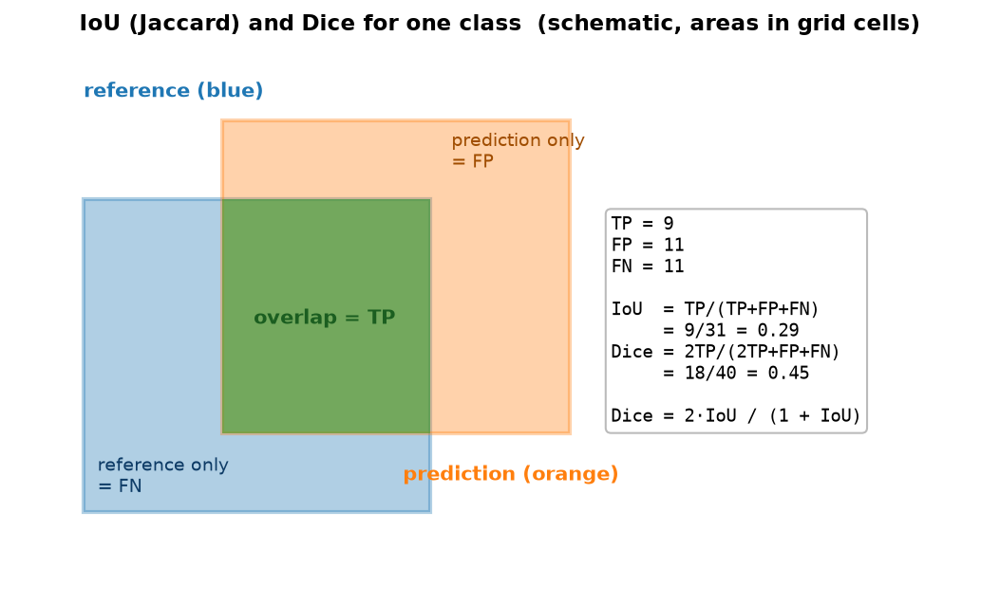

# Glossary & Learning Guide — Wildfire Burn Scar Segmentation

A plain-language reference for every concept this project touches — from "what is a pixel's
reflectance" to "why does a model trained in India fail in Siberia" — with, for each idea,
*what it is*, *why it mattered here*, and where to learn more (full list in §14).

**How to read it.** Sections run roughly in the order the pipeline uses them. Entries marked
*In this project* say what we actually did and why; entries marked *Pitfall* record something that went
wrong. Figures with "schematic" in the caption are teaching diagrams, not measured data; the others are
generated from this project's own logs by `docs/make_figures.py`.

**Contents**
1. [The project in one picture](#1-the-project-in-one-picture)
2. [Satellite & remote-sensing basics](#2-satellite--remote-sensing-basics)
3. [Atmosphere, clouds, smoke & geometry artefacts](#3-atmosphere-clouds-smoke--geometry-artefacts)
4. [Spectral indices & burn severity](#4-spectral-indices--burn-severity)
5. [Fire ecology & the four biomes](#5-fire-ecology--the-four-biomes)
6. [Reference datasets used or considered](#6-reference-datasets-used-or-considered)
7. [Geospatial data & tooling](#7-geospatial-data--tooling)
8. [Machine-learning fundamentals](#8-machine-learning-fundamentals)
9. [Segmentation architecture](#9-segmentation-architecture)
10. [Training](#10-training)
11. [Evaluation metrics](#11-evaluation-metrics)
12. [Class imbalance, calibration & domain shift](#12-class-imbalance-calibration--domain-shift)
13. [Experimental methodology & pitfalls](#13-experimental-methodology--pitfalls)
14. [Why we chose X — decision table](#14-why-we-chose-x--decision-table) · [15. References & where to learn more](#15-references--where-to-learn-more)

---

## 1. The project in one picture

Satellites measure reflected light in many wavelength bands. Fire changes how vegetation reflects
near- and short-wave-infrared light, so comparing the same place **before** and **after** a fire yields a
per-pixel *burn-severity* signal. We turn that signal into labels, train a neural network to predict severity
from the raw pre/post bands, and then ask the scientific question: **does the model still work in other
ecosystems?** (Answer so far: not well — see Stage 6.)

---

## 2. Satellite & remote-sensing basics

**Electromagnetic spectrum** — the range of light wavelengths. Human eyes see ≈ 400–700 nm; satellites
also record near-infrared (NIR, ≈ 700–1300 nm) and short-wave infrared (SWIR, ≈ 1300–2500 nm). Different
materials reflect and absorb different wavelengths, which is what makes remote sensing informative.

**Reflectance** — the fraction of incoming sunlight a surface sends back, per wavelength. *Top-of-atmosphere*
(TOA, Sentinel-2 "L1C") includes atmospheric effects; *surface/bottom-of-atmosphere* (BOA, "L2A") has had
them modelled out. *In this project:* all data are L2A surface reflectance.

**Spectral band** — one wavelength slice recorded by the sensor (e.g. B4 = red, 665 nm). A band is just a
2-D grid of numbers. Our model sees 24 such grids stacked (12 pre-fire + 12 post-fire).

**Spectral signature** — how a material's reflectance varies across bands. Healthy leaves: low red (chlorophyll
absorbs), very high NIR (leaf-cell structure scatters), low SWIR (leaf water absorbs). Burned ground: low NIR,
higher SWIR (charcoal, ash, dry soil, no leaf water).

**Sentinel-2** — a pair of ESA satellites (2A 2015, 2B 2017) carrying the MultiSpectral Instrument: 13 bands,
290 km swath, ≈ 5-day revisit with both satellites at the equator, free and open. *Why here:* 10 m pixels
and the NIR/SWIR bands needed for burn indices, plus easy access through Earth Engine.

**Spatial resolution / GSD** — ground size of one pixel: 10 m (B2, B3, B4, B8), 20 m (B5–B7, B8A, B11, B12),
60 m (B1, B9, B10). *In this project:* everything exported at 10 m, so 20 m bands (including B12, the SWIR band
in NBR) are **interpolated**, not truly 10 m detail — a documented limitation, not a bug.

**Digital number (DN) scaling** — L2A reflectance is stored as integers ×10 000 (0.25 reflectance = 2500).
*In this project:* inputs are divided by 10 000 before entering the network; stored as `int16`.
*Pitfall:* median composites in Earth Engine come back as floats; cast explicitly (`toInt16`) before export.

**Processing baseline / HARMONIZED** — ESA changes its processing chain over time. From 25 Jan 2022 L2A
values carry a +1000 offset; the `S2_SR_HARMONIZED` collection removes it so 2020 and 2023 scenes are comparable.
*Why it matters:* pre- and post-fire scenes processed with different baselines would otherwise differ for
non-fire reasons.

**MGRS tile / UTM zone** — Sentinel-2 data are cut into ≈ 110 × 110 km tiles named like `T45QUE`, based on
UTM zones (6° of longitude wide). Two adjacent tiles are processed independently, so their radiometry can
differ slightly. *Pitfall:* an AOI spanning two tiles gives nodata gaps or a visible seam (our Similipal and
early Yakutia previews). *Rule adopted in Stage 6:* AOI inside one tile, both dates from the same tile.

**Relative orbit** — the satellite's repeating ground track (`R033`, `R067`, … in product IDs). Scenes from
different relative orbits see the ground at different view angles, another source of seams.

**Revisit time & temporal windows** — a place is imaged every ≈ 2–5 days, but only some passes are cloud-free.
We search a *window* (e.g. 15 Jan–5 Feb) rather than a single day.

**True-colour vs false-colour composite** — which three bands are shown as red/green/blue. True colour = B4/B3/B2
(what a camera would see). False colour *SWIR2/NIR/Red* (B12/B8/B4) makes healthy vegetation green and burn
scars dark red/brown, so it is the standard way to eyeball burns.

**Percentile (contrast) stretch** — rescaling band values between, say, their 2nd and 98th percentile to 0–1 for
display. *Pitfall:* if nodata (−32768) is included in the percentile calculation, the range collapses and the
image looks black/white. Always **mask nodata first**.

**Nodata** — a reserved value marking "no measurement here" (we have −32768 in some rasters, 0 in others). Any
statistic must exclude it or it silently corrupts results.

**Resampling** — changing a raster's pixel grid. *Nearest-neighbour* copies the closest value (right for
categorical masks); *bilinear/cubic* interpolate (right for continuous reflectance). We used
`scipy.ndimage.zoom(order=0)` to align masks.

**Mosaic / composite / median composite** — combining several scenes into one. A per-pixel *median* across dates
suppresses transient clouds. *Trade-off:* it can blend different dates and acts badly when only one scene covers
a pixel (no smoothing), or when change (fire!) happens inside the window.

**Phenology** — the seasonal cycle of vegetation (leaf-out, greening, leaf-drop). Satellite indices cannot tell
phenology from fire damage unless you control for it. See *phenology confound*, §4.

---

## 3. Atmosphere, clouds, smoke & geometry artefacts

**Atmospheric correction (Sen2Cor)** — modelling and removing scattering/absorption by gases and aerosols to get
surface reflectance. Imperfect under heavy smoke or haze.

**Cloud, cloud shadow, cirrus** — clouds are bright and opaque; their shadows are dark; thin cirrus can be nearly
invisible yet shifts all bands. *In this project:* we filtered scenes by `CLOUDY_PIXEL_PERCENTAGE` and then
**looked at them** — the metadata is **per scene**, not per AOI. *Better options:* pixel masks such as
s2cloudless or Cloud Score+ (see §15).

**Aerosol optical thickness (AOT) / smoke** — how much light aerosols (smoke, dust, haze) block. Smoke is
spectrally unlike cloud, so cloud filters miss it. Yakutia 2021 and Pantanal 2020 were both heavily smoke-affected.

**Active-fire thermal contamination** — a burning pixel emits thermal radiation that leaks into the SWIR bands,
giving impossible reflectances (we saw B11/B12 maxima > 12 000 where valid values stay ≲ 8 000). *Symptom check:*
print per-band min/max/percentiles.

**BRDF / sun angle** — reflectance depends on the angle between sun, surface and sensor. Different dates and
latitudes ⇒ different geometry ⇒ apparent change that is not real.

**Topographic illumination effect** — sun-facing slopes are brighter than shaded ones. When composites from
different dates/years are *differenced*, terrain shading does not cancel, producing ridge-line speckle (this killed
our multi-year anomaly baseline in Stage 2). Fix needs a DEM-based correction (C-correction, Teillet 1982).

**Seam / tile boundary artefact** — a straight-line colour discontinuity where two tiles or dates meet.

---

## 4. Spectral indices & burn severity

**NDVI** — `(NIR − Red)/(NIR + Red)`; greenness. Not used directly, but conceptually the parent of NBR.

**NBR (Normalized Burn Ratio)** — `NBR = (NIR − SWIR)/(NIR + SWIR)` (here B8 and B12). High for healthy
vegetation, ≈ 0 or negative for burned/bare ground.

**dNBR** — `dNBR = NBR_pre − NBR_post`. Large positive = large loss of healthy vegetation signal. Scaled ×1000 in
the literature. The standard remote-sensing burn-severity measure (Key & Benson 2006).

*Key & Benson classes (dNBR×1000):* −100…+99 unburned · +100…+269 low · +270…+439 moderate-low ·
+440…+659 moderate-high · ≥ +660 high (negative values = regrowth).

**RdNBR (relative dNBR)** — `RdNBR = dNBR / √|NBR_pre|` (Miller & Thode 2007). Normalises the change by how much
healthy vegetation was there to start with, so sparse and dense stands are compared fairly. Literature thresholds
(Sierra Nevada conifers): unburned < 69, low 69–315, moderate 315–640, high > 640.
*Pitfall:* when `|NBR_pre|` is near 0 (bare ground, water) the division explodes — we saw RdNBR range from −32 894 to
+18 458 and "84 % burned". *In this project:* RdNBR only inside a vegetation mask.
*Alternative:* RBR (Parks et al. 2014) uses `dNBR/(NBR_pre + 1.001)` and avoids the singularity — a good candidate
for future work.

**Burn severity vs fire severity vs fire intensity** — *intensity* = energy released by the fire; *fire severity* =
ecological loss caused; *burn severity* = the (often remotely sensed) change after the fire (Keeley 2009). Our
labels are **burn severity proxies**, not field-measured severity.

**Threshold calibration** — literature thresholds were fitted to specific ecosystems; they do not transfer
automatically. *In this project:* we shifted the RdNBR cut-offs by **+380** until burned area ≈ 28.7 % of vegetated land
(consistent with the reported ≈ one-third of the reserve) and the overlay traced the known scar. This is a
**calibration compromise verified by eye**, not an independent ground truth.

**Phenology confound** — NIR falls (and SWIR rises) when deciduous trees drop leaves in the dry season, exactly like
fire. Pre-/post-fire windows that straddle leaf-drop (Sal in Similipal), leaf-out (larch in Yakutia) or the flood
cycle (Pantanal) mix both signals. It dominated Stage 2.

**Background-drift / reference-pixel correction** — subtract the dNBR seen in confirmed-unburned pixels. *Tried and
rejected:* the "unburned" reference (MODIS MCD64A1 + FIRMS) systematically missed under-canopy surface fires, so the
correction erased real burn signal.

**Multi-year anomaly baseline** — compare this year's change with the change in non-fire years. *Tried and rejected:*
differencing independently built composites compounds their noise and exposes terrain-illumination speckle.

**Vegetation mask (land-cover mask)** — restricts analysis to pixels where something can burn. Non-vegetated pixels
become `not_applicable` (code 4 → 255 → `ignore_index`).

**Majority (mode) filter** — replace each pixel by the most common class in its neighbourhood to remove speckle.
Tried in Stage 2, not used in the final pipeline.

---

## 5. Fire ecology & the four biomes

**Surface fire vs crown fire vs ground (peat) fire** — surface fires burn litter/understory under an intact canopy
(satellite sees only a subtle change); crown fires consume the canopy (large, obvious change); ground fires smoulder in
organic soils (hard to see, long-lasting). The same *burn severity class* therefore means different physical things in
different biomes.

**Fuel type / load / moisture** — what is burning, how much, how dry. Drives fire behaviour and how it appears
spectrally.

**Fire regime** — typical frequency, season, size and severity of fires in an ecosystem (Bowman et al. 2009).

**Post-fire recovery / regrowth** — vegetation greening back; fast in the tropics (can mask the scar within weeks),
slow in boreal and arid systems. Why the *timing* of the post-fire image matters.

**Tropical dry deciduous (Sal) forest — Similipal** — *Shorea robusta* forest in Odisha that sheds leaves in the late dry
season. 2021 fire: detections from ≈ 11 Feb to 15 Mar, rain on 10 Mar, > 10 days burning, roughly a third of the reserve;
largely surface fire. Training domain.

**Wetland / savanna — Pantanal** — the world's largest tropical wetland, driven by an annual flood pulse; 2020 saw
extreme drought and record burning (≈ 30 % of the Brazilian Pantanal). Vegetation (grass, herbaceous wetland, gallery
forest) and baseline NBR differ strongly from Sal forest.

**Mediterranean pine forest & maquis — North Evia** — Aleppo/Calabrian pine forest, shrubland and olive groves; hot dry
summers, fire-adapted, fast wind-driven crown fires. August 2021 fire burned tens of thousands of hectares in a few days.

**Boreal taiga & larch — Central Yakutia** — northern forest dominated by deciduous larch over permafrost; low sun angle,
short growing season, snow; fires are large and stand-replacing. 2021 was a record season with heavy smoke.

---

## 6. Reference datasets used or considered

| Dataset | What | Role here |
|---|---|---|
| **Sentinel-2 L2A** (`COPERNICUS/S2_SR_HARMONIZED`) | optical imagery, 10–60 m | all model inputs and RdNBR |
| **ESA WorldCover v200** | 10 m global land cover for 2021: 10 tree, 20 shrub, 30 grass, 40 crop, 50 built, 60 bare, 70 snow, 80 water, 90 herbaceous wetland, 95 mangrove, 100 moss/lichen | vegetation masks (class list chosen per biome) |
| **MODIS MCD64A1** | 500 m monthly burned-area product | tried as unburned reference; rejected (omission under canopy) |
| **FIRMS / VIIRS active fire** | thermal hotspots, near-daily | tried with MCD64A1; rejected |
| **MTBS** | US-only Landsat burn-severity maps | the product we could *not* use outside the US (hence DIY labels) |
| **Copernicus EMS rapid mapping** | event-triggered damage maps | available for Evia; not for Similipal (India rarely requests it) |
| **GWIS / GlobFire; MapBiomas Fogo** | global / Brazilian burned-area products | candidate independent references for future work |

---

## 7. Geospatial data & tooling

**CRS / EPSG:4326** — coordinate reference system; 4326 = WGS84 latitude/longitude in degrees. *Gotcha:* one degree of
longitude shrinks with latitude (≈ 111 km × cos φ), so "0.3° wide" is ≈ 31 km at the equator but ≈ 16 km at 62° N.

**GeoTIFF** — an image file with georeferencing metadata. Our rasters are `(bands, height, width)` arrays.
Rasterio reads band *k* with `src.read(k)` (**1-indexed**).

**AOI (area of interest) / bounding box** — the rectangle we process. *Rule:* small enough to lie in one tile.

**Google Earth Engine (GEE)** — a cloud platform that evaluates *lazy* computation graphs on petabytes of imagery.
`getInfo()` forces evaluation (and counts against concurrency limits — HTTP 429 "too many requests").
*Pitfall:* downloads can fail silently; **verify bands and file size afterwards**.

**geemap / geedim** — Python helpers; `geemap.download_ee_image` tiles large exports through geedim.
**rasterio / GDAL** — read/write rasters. **NumPy / SciPy** — array maths, `zoom`, `generic_filter`.
**scikit-learn** — `train_test_split` (note: pip name is `scikit-learn`, import name `sklearn`).
**PyTorch / segmentation_models_pytorch (smp)** — deep-learning framework and a library of segmentation models.
**MPS** — PyTorch's Apple-Silicon GPU backend (we trained on an M4 Mac). **Matplotlib** — plotting.

---

## 8. Machine-learning fundamentals

**Supervised learning** — learn a mapping from inputs to known labels. Here: 24-band patch → severity map.

**Semantic segmentation** — assign a class to *every pixel* (vs classification = one label per image, detection = boxes).

**Tensor / channels** — a tensor is an n-dimensional array; an image batch is `(batch, channels, H, W)`. Our input has 24 channels.

**Neural network, layer, parameter (weight)** — stacked functions with learnable numbers. **Hyperparameters** (learning rate,
batch size, patch size) are set by you, not learned.

**Convolution** — a small learned filter slid across the image, detecting local patterns. **ReLU** — activation `max(0,x)`
adding non-linearity. **Pooling / stride** — downsampling. **Batch normalisation** — rescales activations per mini-batch to
stabilise training. **Receptive field** — how much of the input one output pixel "sees".

**Forward pass, loss, backpropagation, gradient descent** — predict → measure error → compute how each weight should change →
update. **Learning rate** — step size (we used 1e-4). **Adam** — adaptive optimiser, a robust default (Kingma & Ba 2015).

**Epoch / batch / iteration** — one pass over the data / the examples per weight update (we used 8) / one update.

**Softmax** — turns raw scores (*logits*) into probabilities that sum to 1: `p_c = e^{z_c}/Σ e^{z_j}`. **Argmax** — pick the
largest. Softmax probabilities are *not* guaranteed to be calibrated (§12).

**Cross-entropy loss** — `−log p_true`; punishes confident mistakes. **Weighted cross-entropy** — multiply each class's loss
by a weight. **`ignore_index`** — pixels with this label contribute nothing (we used it for `not_applicable`).

**Generalisation** — performance on data not used for training. **Overfitting** — memorising training quirks: train loss
falls, validation stalls or rises. **Underfitting** — too simple to fit even the training data.

**Train / validation / test** — train fits weights; validation tunes choices (checkpoint, hyperparameters); **test** gives a
final unbiased score and must not influence any choice. *Our gap:* we have no separate test set (§13).

**Stratified split** — keep class/category proportions equal across splits. **Random seed** — fixes pseudo-randomness for
reproducibility (we did not record seeds for training).

**Checkpoint / best-of-N selection** — we save the weights with the best validation mean IoU (epoch 47). Selecting the best of
50 noisy numbers and reporting it on the same set is optimistically biased (the "winner's curse").

---

## 9. Segmentation architecture

**Encoder–decoder** — the encoder compresses the image into abstract features ("what"); the decoder expands them back to
pixel resolution ("where").

**U-Net** (Ronneberger et al. 2015) — encoder–decoder with **skip connections** that copy fine-detail feature maps from encoder
levels straight into the matching decoder levels, giving sharp boundaries.

**ResNet / residual connection / ResNet34** (He et al. 2016) — layers learn a *residual* added to their input, which makes deep
networks trainable. ResNet34 has 34 layers; we use it as the U-Net encoder.

**segmentation_models_pytorch `Unet`** — builds the above: `encoder_name="resnet34"`, `in_channels=24`, `classes=4`,
decoder channels 256-128-64-32-16, roughly 24 M parameters.

**Transfer learning / pretrained weights / ImageNet** — start from weights learned on a large dataset. Works because early
layers learn generic edges/textures *of RGB photographs*. **We could not use it:** our input is 24 bands of reflectance, not
RGB, so `encoder_weights=None` (random initialisation, "from scratch"). Consequence: more data and epochs are needed.

**Input-channel adaptation** — changing the first convolution to accept 24 instead of 3 channels.

---

## 10. Training

**Class weighting (inverse frequency)** — weight_c = total / (n_classes × count_c). Our weights: 0.36 / 1.06 / 3.60 / **91.2**
for unburned / low / moderate / high.

**Patch, tile (ML sense), stride, overlap** — we cut 256 × 256 crops every 128 px (50 % overlap), then stacked pre + post
bands → 24 × 256 × 256. Overlap gives more fire-containing examples but makes neighbouring patches share pixels.

**Patch filtering** — dropped patches with > 50 % `not_applicable` or > 5 % nodata. **`has_fire`** — patch with ≥ 5 % burned pixels,
used only for stratifying the split (an `.any()` test flagged 100 % of patches and was useless).

**Learning curves** — plot loss/IoU against epochs to spot overfitting and noise.

*Reading it:* train loss falls smoothly; validation metrics are noisy (small set, rare class), so the **best epoch (47) ≠ last
epoch (50)** — hence checkpointing on mean IoU.

**Training from scratch on a small set** — 1 262 training patches is small for a 24 M-parameter network. **Data
augmentation** (flips, rotations) would help and was not used.

**Device / MPS** — hardware used for computation; MPS = Apple GPU.

---

## 11. Evaluation metrics

**Confusion matrix** — rows = reference class, columns = predicted class, cells = pixel counts. Row-normalising gives
**recall** per class; column-normalising gives **precision**.

**TP / FP / FN / TN** — true/false positives/negatives for one class.

**Precision** = TP/(TP+FP) — of what I called *c*, how much was right. **Recall (sensitivity)** = TP/(TP+FN) — of what truly was
*c*, how much did I find. **F1 / Dice** = 2TP/(2TP+FP+FN) — their harmonic-mean-like balance.

**IoU / Jaccard** = TP/(TP+FP+FN) — overlap divided by union; stricter than Dice. `Dice = 2·IoU/(1+IoU)`.

**Mean IoU** — unweighted average of per-class IoU. Treats a 0.24 %-prevalence class like a 60 %-prevalence class, so it is
dominated by the hardest rare class. **Pixel accuracy** — fraction correct; misleading under imbalance (predicting "unburned"
everywhere gets 60 %+).

**Cohen's κ** — agreement corrected for chance; 0 = no better than chance, 1 = perfect. Useful across scenes with different
prevalence, though debated (Pontius & Millones 2011).

**Prevalence effect** — IoU of a class that fills most of the scene is easy to make high. Evia's `high` IoU of 0.78 and
Yakutia's `unburned` 0.85 largely reflect that (84 % and 88 % of the reference pixels).

**Micro vs macro averaging** — pooling all pixels vs averaging per class. Mean IoU is macro.

*Reading it:* `high_severity` has recall 0.92 but precision 0.21 in-domain — the 91× weight made the model call it liberally.
In Pantanal this *reverses* (precision 0.92, recall 0.30).

**Accuracy assessment practice** — for area estimates and uncertainty, probability-based sampling and stratified estimators
are recommended over pixel counts (Olofsson et al. 2014).

---

## 12. Class imbalance, calibration & domain shift

**Class imbalance** — rare classes get little gradient. Remedies: loss weighting (used), focal loss (down-weights easy pixels,
Lin et al. 2017), oversampling rare patches, class-balanced loss by effective number of samples (Cui et al. 2019).

**Domain / dataset shift** — training and deployment distributions differ. Types: **covariate shift** (inputs P(x) change, e.g.
different baseline reflectance), **prior / label shift** (class frequencies P(y) change, e.g. Pantanal has more severe pixels),
**concept shift** (the input→label relationship changes). Real cases mix them.

**Domain gap** — the performance loss caused by domain shift. **Zero-shot / out-of-distribution evaluation** — test on a new
domain with no fine-tuning (our Stage 6).

**Domain adaptation** — methods to reduce the gap: fine-tuning with a few target labels, **AdaBN** (re-estimate batch-norm
statistics on the target scene), **Tent** (entropy minimisation at test time), adversarial feature alignment, per-scene
normalisation. We implemented none; they are the natural next step.

**Model calibration** — whether predicted probabilities match observed frequencies (Guo et al. 2017). Networks are often
over-confident out-of-domain.

**Logit adjustment / prior correction** — shift logits by a class-dependent term to change the decision rule or adapt to new
class priors (Saerens et al. 2002; Menon et al. 2021). Also the basis of black-box label-shift estimators (Lipton et al. 2018).

**Baseline-conditioned recalibration (this project)** — `ŷ = argmax_c [log p_c + α · c · s]`, with *s* = pre-fire NBR shift from
Similipal and *c* the ordinal class index. A one-parameter, ordinal-aware logit adjustment.

*What the experiment showed:* helps in Pantanal (+0.048 mean IoU, 9.7 % of the gap), no-op where *s* ≈ 0 — but α was tuned
on the scoring labels, the best α is at the grid edge, and a large α behaves like a prior shift. Details: Stage 6 README §8.

**Ordinal classification** — classes with a natural order (unburned < low < moderate < high); errors between neighbours are
less bad than distant ones. Plain cross-entropy ignores this.

**Hyper-parameter sweep / grid edge** — scanning a parameter over a list; if the best value is the last one tried, the optimum
is not bracketed.

**Baseline NBR shift** — mean pre-fire NBR of a region minus Similipal's. A cheap *covariate-shift* descriptor.

---

## 13. Experimental methodology & pitfalls

**Data leakage** — information from outside the training set sneaking into evaluation, inflating scores (Kapoor & Narayanan 2023).

**Spatial autocorrelation** (Tobler's first law: near things are more alike) — neighbouring pixels/patches are not independent.
Randomly splitting overlapping patches puts near-duplicates in train and validation ⇒ **spatial leakage** (Kattenborn et al. 2022;
Ploton et al. 2020). *Our case:* 50 %-overlap patches split randomly ⇒ the in-domain 0.6659 is optimistic. *Fix:* **spatially
blocked cross-validation** (Roberts et al. 2017): split by geographic blocks with buffers.

**Label–input circularity** — if labels are computed from the same bands the model sees (ours: B8/B12 pre/post → RdNBR →
classes), the model can learn the labelling formula; high IoU then shows it re-learned the rule, not that it detects fire
independently.

**Proxy / weak labels** — labels derived from an index or a model rather than from field observation. Errors in the proxy
become errors in "ground truth".

**Label-protocol mismatch** — training labels (calibrated +380 rule) vs zero-shot reference labels (default rule) are not the
same function. Some of the measured gap may be protocol, not ecology (Stage 6 §10-3; test with
`decompose_gap_by_label_rule.py`).

**Confound** — a variable that changes together with the one you care about (season changes with fire; scene composition changes
with biome) so effects cannot be separated without a controlled comparison.

**Ablation** — remove or swap one component to measure its effect. **Controlled comparison** — change one thing at a time.

**Selection bias / winner's curse** — picking the best of many noisy trials and reporting its score.

**Sample size & uncertainty** — three regions, one fire each, one training run: no confidence intervals, no significance tests.
Statements about trends ("shift predicts drop") are descriptive at n = 3.

**Independent test set** — data touched by no decision. Needed for an honest headline number.

**Reproducibility** — fixed seeds, pinned package versions, logged scene IDs, scripts in run order. (We logged scripts and
parameters; seeds and some scene IDs are still to be recorded.)

**Silent failure** — a step that "succeeds" with bad output (partial download, nodata-skewed preview, wrong AOI).
*Practice:* assert on outputs (band count, % non-zero, file size, coverage ≥ 95 %).

---

## 14. Why we chose X — decision table

| Decision | Why | Known cost |
|---|---|---|
| Sentinel-2 L2A at 10 m | free, frequent, has NIR/SWIR, GEE access | SWIR is 20 m (resampled) |
| Earth Engine Python API | planetary archive without downloads | rate limits; silent partial downloads |
| NBR from B8 & B12 | standard burn index inputs | B12 coarser than B8 |
| RdNBR not dNBR | heterogeneous cover; relative change | unstable at low NBR |
| WorldCover vegetation mask | nothing to burn on rock/water; avoids RdNBR blow-ups | 2021 map; class choice is a judgement |
| +380 threshold offset | phenology made literature thresholds label ≈ 91 % "burned" | tuned by eye; not field-validated |
| 24-channel pre+post stack | lets the net learn change directly | no ImageNet pretraining possible |
| U-Net + ResNet34 | proven segmentation design; manageable on a laptop | trained from scratch on 1.3 k patches |
| 256 px patches, stride 128 | fits memory; more fire examples | overlap ⇒ leakage if split randomly |
| Weighted CE (≈91× on `high`) | stop the 0.24 % class being ignored | precision 0.21 on `high` |
| `ignore_index` for `not_applicable` | not a fire class; avoids diluting the task | needs the mask at inference |
| Adam, lr 1e-4, batch 8, 50 epochs | robust defaults for a first run | not tuned |
| Best-mean-IoU checkpoint | validation is noisy | optimistic, no test set |
| Zero-shot to 3 biomes | measures real generalisation | one event per biome |
| Single scene, tile-pinned, AOI < tile | removes seams/nodata/blended contamination | small AOIs |
| Baseline-conditioned logit bias | cheap, label-free signal (pre-fire NBR) | α tuned in-sample; heuristic |

---

## 15. References & where to learn more

### Courses and books (machine learning)
* Stanford **CS231n** — Convolutional Neural Networks for Visual Recognition: <https://cs231n.stanford.edu>
* **fast.ai** Practical Deep Learning: <https://course.fast.ai>
* **Dive into Deep Learning** (free, interactive): <https://d2l.ai>
* Goodfellow, Bengio & Courville, **Deep Learning** (free online): <https://www.deeplearningbook.org>
* 3Blue1Brown, *Neural Networks* video series: <https://www.3blue1brown.com/topics/neural-networks>
* Andrej Karpathy, *Neural Networks: Zero to Hero*: <https://karpathy.ai/zero-to-hero.html>
* **PyTorch tutorials**: <https://pytorch.org/tutorials> · `CrossEntropyLoss`: <https://pytorch.org/docs/stable/generated/torch.nn.CrossEntropyLoss.html> · MPS backend: <https://pytorch.org/docs/stable/notes/mps.html>
* scikit-learn, *Model evaluation* (confusion matrix, precision/recall, κ): <https://scikit-learn.org/stable/modules/model_evaluation.html>
* `segmentation_models_pytorch`: <https://github.com/qubvel-org/segmentation_models.pytorch> (formerly `qubvel/…`)

### Remote sensing, fire and Earth Engine
* ESA **SentiWiki** (Sentinel-2 mission, bands, processing baselines): <https://sentiwiki.copernicus.eu>
* NASA **ARSET** free trainings (remote sensing, fire, land cover): <https://appliedsciences.nasa.gov/what-we-do/capacity-building/arset>
* **UN-SPIDER Recommended Practice: Burn Severity Mapping** (Sentinel-2 dNBR in Earth Engine): <https://un-spider.org/advisory-support/recommended-practices/recommended-practice-burn-severity>
* Google **Earth Engine** guides and dataset catalogue: <https://developers.google.com/earth-engine> · `COPERNICUS/S2_SR_HARMONIZED`: <https://developers.google.com/earth-engine/datasets/catalog/COPERNICUS_S2_SR_HARMONIZED>
* **geemap**: <https://geemap.org> · **geedim**: <https://geedim.readthedocs.io> · **rasterio**: <https://rasterio.readthedocs.io> · **GDAL**: <https://gdal.org>
* Cardille, Crowley, Saah & Clinton (eds.), *Cloud-Based Remote Sensing with Google Earth Engine* (Springer, open access)
* Lillesand, Kiefer & Chipman, *Remote Sensing and Image Interpretation* (Wiley); Jensen, *Remote Sensing of the Environment* (Pearson)
* Datasets: ESA WorldCover <https://esa-worldcover.org> · MODIS MCD64A1 <https://lpdaac.usgs.gov/products/mcd64a1v061/> · NASA FIRMS <https://firms.modaps.eosdis.nasa.gov> · MTBS <https://www.mtbs.gov> · Copernicus EMS <https://emergency.copernicus.eu>
* Cloud masking: s2cloudless <https://github.com/sentinel-hub/sentinel2-cloud-detector>; **Cloud Score+** (Earth Engine `GOOGLE/CLOUD_SCORE_PLUS/V1/S2_HARMONIZED`)

### Papers — burn severity and fire
* Key, C. H. & Benson, N. C. (2006). Landscape Assessment: ground measure of severity, the Composite Burn Index; and remote sensing of severity, the Normalized Burn Ratio. In Lutes et al., *FIREMON*, USDA Forest Service GTR **RMRS-GTR-164-CD**.
* Miller, J. D. & Thode, A. E. (2007). Quantifying burn severity in a heterogeneous landscape with a relative version of the delta Normalized Burn Ratio (dNBR). *Remote Sensing of Environment* 109(1):66–80.
* Miller, J. D. et al. (2009). Calibration and validation of the relative differenced Normalized Burn Ratio (RdNBR) … *Remote Sensing of Environment* 113(3):645–656.
* Parks, S. A., Dillon, G. K. & Miller, C. (2014). A new metric for quantifying burn severity: the Relativized Burn Ratio. *Remote Sensing* 6(3):1827–1844.
* Keeley, J. E. (2009). Fire intensity, fire severity and burn severity: a brief review and suggested usage. *International Journal of Wildland Fire* 18:116–126.
* Giglio, L. et al. (2018). The Collection 6 MODIS burned area mapping algorithm and product. *Remote Sensing of Environment* 217:72–85.
* Bowman, D. M. J. S. et al. (2009). Fire in the Earth system. *Science* 324:481–484.
* Flannigan, M. D. et al. (2009). Implications of changing climate for global wildland fire. *Int. J. Wildland Fire* 18:483–507.
* Libonati, R. et al. (2020). Rescue Brazil's burning Pantanal wetland. *Nature Ecology & Evolution* 4:1365–1367.
* Magalhães Neto, N. et al. (2022). Human activity behind the unprecedented 2020 wildfire in Brazil's Pantanal. *Frontiers in Environmental Science*.
* Features of the extreme fire season of 2021 in Yakutia … *Remote Sensing* 14(19):4980, <https://doi.org/10.3390/rs14194980>; Classification of fire damage to boreal forests of Siberia in 2021 based on the dNBR index, *Fire* 5(1):19.
* Similipal 2021 coverage: Mongabay-India, "One year of Similipal forest fire: the hits and misses" (Apr 2022); Down To Earth, "Similipal fire serves as lesson on human activity within protected areas".
* Teillet, P. M., Guindon, B. & Goodenough, D. G. (1982). On the slope-aspect correction of multispectral scanner data. *Canadian Journal of Remote Sensing* 8(2); Riaño, D. et al. (2003). *IEEE TGRS* 41(5):1056–1061.
* Drusch, M. et al. (2012). Sentinel-2: ESA's optical high-resolution mission. *RSE* 120:25–36. Gorelick, N. et al. (2017). Google Earth Engine. *RSE* 202:18–27. Zanaga, D. et al. ESA WorldCover 10 m 2021 v200, doi:10.5281/zenodo.7254221.

### Papers — machine learning
* Ronneberger, Fischer & Brox (2015). **U-Net**. arXiv:1505.04597
* He, Zhang, Ren & Sun (2016). **Deep Residual Learning for Image Recognition**. arXiv:1512.03385
* Kingma & Ba (2015). **Adam**. arXiv:1412.6980 · Ioffe & Szegedy (2015). **Batch Normalization**. arXiv:1502.03167 · He et al. (2015). Delving deep into rectifiers (Kaiming init). arXiv:1502.01852
* Yosinski et al. (2014). How transferable are features in deep neural networks? arXiv:1411.1792
* Lin et al. (2017). **Focal Loss**. arXiv:1708.02002 · Cui et al. (2019). Class-balanced loss based on effective number of samples. arXiv:1901.05555 · Buda, Maki & Mazurowski (2018). Class imbalance in CNNs. arXiv:1710.05381 · He & Garcia (2009). Learning from imbalanced data. *IEEE TKDE* 21(9):1263–1284
* Quiñonero-Candela et al. (2009). *Dataset Shift in Machine Learning* (MIT Press) · Shimodaira (2000). Covariate shift. *J. Stat. Plan. Inference* 90 · Ben-David et al. (2010). A theory of learning from different domains. *Machine Learning* 79
* Saerens, Latinne & Decaestecker (2002). Adjusting the outputs of a classifier to new a priori probabilities. *Neural Computation* 14(1) · Lipton, Wang & Smola (2018). Detecting and correcting for label shift with black-box predictors. arXiv:1802.03916 · Menon et al. (2021). Long-tail learning via logit adjustment. arXiv:2007.07314
* Guo et al. (2017). **On Calibration of Modern Neural Networks**. arXiv:1706.04599
* Li et al. (2016). Revisiting batch normalization for practical domain adaptation (**AdaBN**). arXiv:1603.04779 · Wang et al. (2021). **Tent**: fully test-time adaptation by entropy minimization. arXiv:2006.10726
* Kapoor & Narayanan (2023). Leakage and the reproducibility crisis in machine-learning-based science. *Patterns* 4(9)
* Roberts et al. (2017). Cross-validation strategies for data with temporal, spatial, hierarchical, or phylogenetic structure. *Ecography* 40:913–929 · Ploton et al. (2020). Spatial validation reveals poor predictive performance of large-scale ecological mapping models. *Nature Communications* 11:4540 · Kattenborn et al. (2022). Spatially autocorrelated training and validation samples inflate performance assessment of convolutional neural networks. *ISPRS Open J. Photogramm. Remote Sens.* 5:100018
* Powers (2011). Evaluation: from precision, recall and F-measure to ROC, informedness, markedness and correlation. arXiv:2010.16061 · Maier-Hein et al. (2024). Metrics reloaded. *Nature Methods* 21:195–212 · Pontius & Millones (2011). Death to Kappa. *Int. J. Remote Sensing* 32(15):4407–4429 · Olofsson et al. (2014). Good practices for estimating area and assessing accuracy of land change. *RSE* 148:42–57
* Paszke et al. (2019). PyTorch. *NeurIPS*.

> Reference details were written from memory of the literature; check titles/years/DOIs against the publisher before citing them formally.